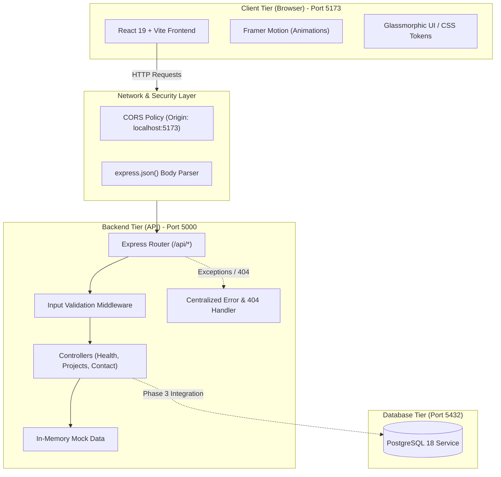
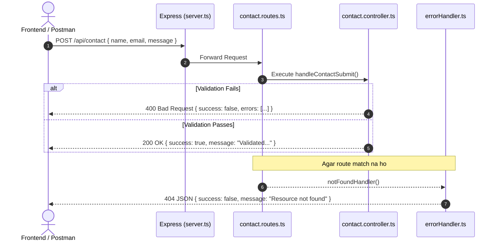

# DevSpace 3D — Full-Stack System Architecture

> **Project Name:** DevSpace 3D  
> **Tech Stack:** React 19, Vite, Framer Motion, Node.js, Express, TypeScript, PostgreSQL  
> **Author:** Chandrabhan  
> **Documentation Type:** High-Level & Detailed Software Architecture  

---

## 1. System Overview (High-Level Architecture)

DevSpace 3D ek **Decoupled Client-Server Architecture** follow karta hai jahan Frontend aur Backend independent services ke roop mein operate karte hain.



---

## 2. Directory Structure Breakdown

```text
project-name/
├── public/                       # Static public assets (Favicon, Vite SVG)
├── src/                          # Frontend Application Code (React 19)
│   ├── assets/                   # Vector graphics (react.svg)
│   ├── components/               # Modular UI blocks
│   │   ├── Navbar.jsx / .css     # Floating glassmorphism navbar + mobile drawer
│   │   ├── Hero.jsx / .css       # Animated hero + 3D code terminal widget
│   │   ├── About.jsx / .css      # Developer bio + 4-step learning timeline
│   │   ├── Skills.jsx / .css     # Interactive tab filter + progress indicators
│   │   ├── Projects.jsx / .css   # 3D hover cards + WIP toast triggers
│   │   └── Footer.jsx / .css     # Responsive footer + social links
│   ├── data/
│   │   └── portfolioData.js      # Single source of truth for frontend data
│   ├── styles/
│   │   ├── index.css             # Design tokens, variables & dark palette
│   │   └── App.css               # Ambient glowing orbs & utility classes
│   ├── App.jsx                   # Master layout container
│   └── main.jsx                  # React DOM mount point
├── backend/                      # Backend REST API Service (Node.js + TypeScript)
│   ├── src/
│   │   ├── controllers/          # Business logic & request handling
│   │   │   ├── health.controller.ts
│   │   │   ├── projects.controller.ts
│   │   │   └── contact.controller.ts
│   │   ├── routes/               # URL endpoint declarations
│   │   │   ├── health.routes.ts   # GET /api/health
│   │   │   ├── projects.routes.ts # GET /api/projects
│   │   │   └── contact.routes.ts  # POST /api/contact
│   │   ├── middleware/
│   │   │   └── errorHandler.ts   # 404 handler & centralized error catcher
│   │   ├── data/
│   │   │   └── projects.data.ts  # Typed sample portfolio dataset
│   │   └── server.ts             # App bootstrap, CORS & listener
│   ├── .env                      # Local environment secrets (ignored by Git)
│   ├── .env.example              # Secret structure template
│   ├── package.json              # Express + TS scripts (dev, build, start)
│   └── tsconfig.json             # TypeScript compiler settings (NodeNext)
├── .gitignore                    # Git security & exclusions
├── index.html                    # Root HTML template with Google Fonts
└── README.md                     # Project documentation
```

---

## 3. Frontend Architecture (React 19 + Vite)

### A. Design System & CSS Tokens
Frontend ko ek premium dark cyberpunk/spatial aesthetic diya gaya hai:
- **Design Tokens (`index.css`):**
  - `--bg-primary: #0a0b12` (Deep space dark)
  - `--accent-cyan: #06b6d4` & `--accent-purple: #8b5cf6` (Gradient accents)
  - `--glass-bg: rgba(18, 19, 36, 0.65)` (Glassmorphic transparency)
- **Spatial Background (`App.css`):**
  - Do ambient radial-gradient orbs CSS keyframe animation se float karte hain, jisse bina heavy 3D rendering ke natural visual depth create hoti hai.

### B. Single Source of Truth (`src/data/portfolioData.js`)
Components hardcoded text use nahi karte; saara data modular state arrays mein partitioned hai:
1. `personalInfo`: Name, bio, social media links.
2. `skills`: Category-wise skills (`Frontend`, `Tools`, `Currently Learning`) aur progress estimates.
3. `projects`: Concept & active projects (DevSpace 3D, AstroExplore, FocusFlow).
4. `learningMilestones`: 4-step progressive timeline.

### C. Component Interaction & Accessibility
- **Framer Motion Integration:** Cards aur tabs par smooth springs aur layout transitions hain.
- **Reduced Motion Support:** `@media (prefers-reduced-motion: reduce)` enabled hai taaki sensitive users ke liye excessive transitions gracefully disable ho sakein.

---

## 4. Backend Architecture (Node.js + Express + TypeScript)

### A. Layered Controller-Route Pattern
Backend ko modular layers mein organize kiya gaya hai:



### B. Endpoints Specification

| Method | Endpoint | Purpose | Request Body | Response Status |
| :--- | :--- | :--- | :--- | :--- |
| `GET` | `/api/health` | Server heartbeat & uptime | None | `200 OK` |
| `GET` | `/api/projects` | Fetch sample portfolio projects | None | `200 OK` |
| `POST` | `/api/contact` | Input validation for contact form | `{ name, email, message }` | `200 OK` / `400 Bad Request` |
| `ALL` | `*` | Catch-all for undefined routes | Any | `404 Not Found` |

### C. Security & Strict Typing
- **CORS Protection:** Sirf `http://localhost:5173` ko backend connect karne ki permission hai.
- **Type Safety:** TypeScript `NodeNext` resolution use karta hai. Controller requests typesafe interfaces (`ContactRequestBody`, `Project`) use karti hain.
- **Centralized Errors:** Har error standard JSON format mein return hota hai; terminal logs server-side rehte hain aur client ko clean error messages milte hain.

---

## 5. Data Flow & Communication Lifecycle

1. **User Interaction:** Client browser mein user action perform karta hai (e.g., Skills category click karna ya contact form fill karna).
2. **Client Validation:** Frontend instant validation feedback deta hai.
3. **HTTP Fetch:** Asynchronous `fetch()` request backend port `5000` par dispatch hoti hai.
4. **CORS Preflight:** Browser check karta hai ki kya backend origin allow karta hai.
5. **Backend Processing:** Express route request ko parse karta hai, sanitize karta hai, aur structured JSON respond karta hai.

---

## 6. DevOps & Infrastructure Setup

- **Version Control:** Git repository initialized on `main` branch.
- **Secret Isolation:** Multi-layer `.gitignore` ensure karta hai ki koi bhi `.env` file ya credentials remote repository par na leak ho.
- **Runtime Environment:** 
  - Frontend: Vite Local Dev Server (`5173`).
  - Backend: Node.js TSX watcher (`5000`).
  - Database: PostgreSQL 18 Service active on port `5432`.
  - Virtualization: Ubuntu WSL2 & Docker Desktop pre-installed.
