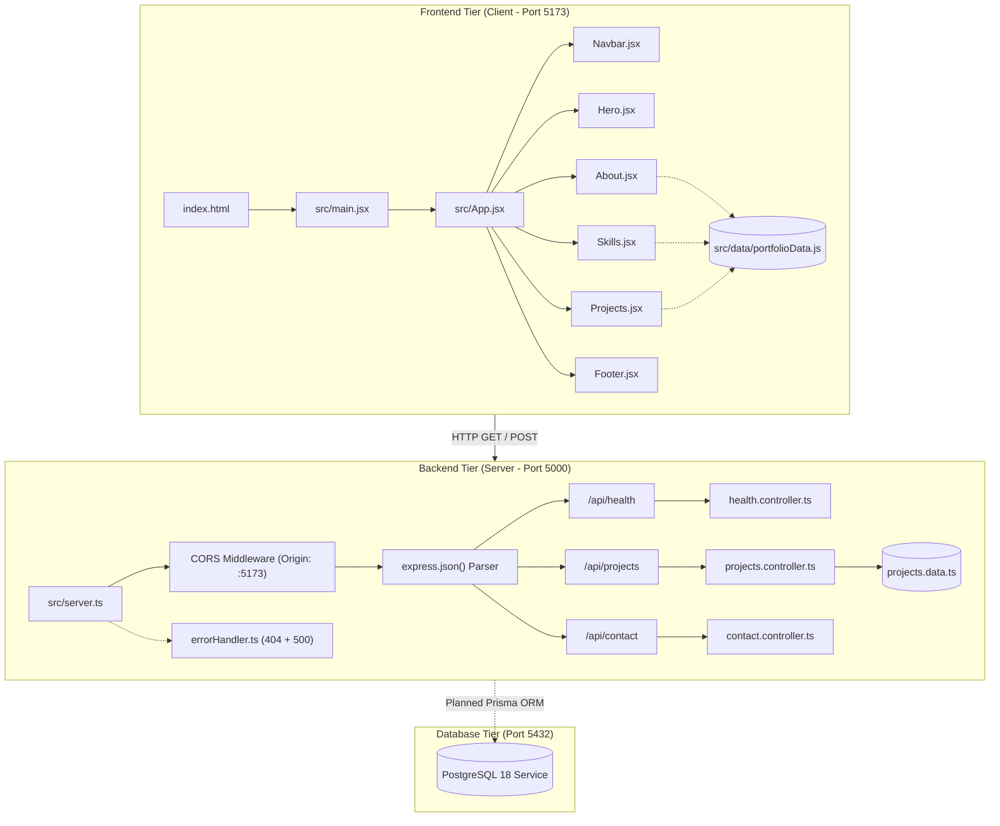
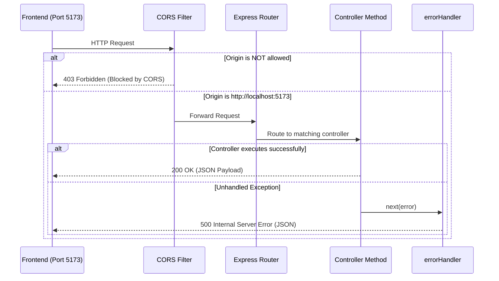

# DevSpace 3D — Master Code Structure & Architecture Guide

> **Project:** DevSpace 3D Portfolio  
> **Repository:** Fullstack (React 19 + Node.js/Express + TypeScript + PostgreSQL Ready)  
> **Target Audience:** Beginners, Developers, Maintainers  
> **Status:** Phase 1 & 2 Completed (Frontend UI + REST API + Git Init)  

---

## 1. High-Level System Architecture

DevSpace 3D ko **Separation of Concerns (SoC)** principle par banaya gaya hai. Frontend aur Backend do independent modules hain jo RESTful HTTP APIs ke zariye communicate karte hain.



---

## 2. Directory Tree & File Inventory

```text
C:\Users\chand\project-name\
│
├── public/                               # Static assets directly exposed to web
│   └── vite.svg                          # Vite logo used in favicon
│
├── src/                                  # React Frontend Source Code
│   ├── assets/                           # Bundled media / SVG assets
│   │   └── react.svg                     # React vector icon
│   │
│   ├── components/                       # Modular UI Components
│   │   ├── Navbar.jsx                    # Floating pill navigation bar
│   │   ├── Navbar.css                    # Glassmorphism & mobile drawer styles
│   │   ├── Hero.jsx                      # Hero section with interactive code widget
│   │   ├── Hero.css                      # Hero layout, animations & code terminal styles
│   │   ├── About.jsx                     # Bio & learning milestones roadmap
│   │   ├── About.css                     # Timeline card layout & glowing badges
│   │   ├── Skills.jsx                    # Category tab filters & progress indicators
│   │   ├── Skills.css                    # Tab active states & progress bar tracks
│   │   ├── Projects.jsx                  # Project cards with WIP toasts & tech tags
│   │   ├── Projects.css                  # 3D hover transforms & reduced-motion support
│   │   ├── Header.jsx                    # Simple reusable header module
│   │   ├── Footer.jsx                    # Social media icon links & copyright
│   │   └── Footer.css                    # Glassmorphic footer layout
│   │
│   ├── data/                             # Single Source of Truth for Content
│   │   ├── portfolioData.js              # Chandrabhan's bio, skills, projects, and milestones
│   │   └── sampleData.js                 # Boilerplate demonstration fixtures
│   │
│   ├── hooks/                            # Reusable Custom React Hooks
│   │   └── useCounter.js                 # Custom state hook for counter logic
│   │
│   ├── pages/                            # Multi-section or Page Views
│   │   └── Home.jsx                      # Home view module
│   │
│   ├── styles/                           # Global Theming & Utilities
│   │   ├── index.css                     # CSS variables, fonts, global resets
│   │   └── App.css               # Ambient 3D glow orbs, buttons, glass cards
│   │
│   ├── App.jsx                           # Primary layout coordinator & section assembler
│   └── main.jsx                          # React 19 application entry point
│
├── backend/                              # Express + TypeScript REST API
│   ├── src/
│   │   ├── controllers/                  # Route handlers & Business Logic
│   │   │   ├── health.controller.ts      # Server uptime & status responder
│   │   │   ├── projects.controller.ts    # Portfolio project feed provider
│   │   │   └── contact.controller.ts     # Input validation (name, email, message)
│   │   │
│   │   ├── routes/                       # Endpoint path declarations
│   │   │   ├── health.routes.ts          # Mounts GET /api/health
│   │   │   ├── projects.routes.ts        # Mounts GET /api/projects
│   │   │   └── contact.routes.ts         # Mounts POST /api/contact
│   │   │
│   │   ├── middleware/                   # Request preprocessing & error handling
│   │   │   └── errorHandler.ts           # JSON 404 handler & centralized catch-all
│   │   │
│   │   ├── data/                         # Typed in-memory mock datasets
│   │   │   └── projects.data.ts          # Project interface & sample projects
│   │   │
│   │   └── server.ts                     # Express server setup, CORS, and port listener
│   │
│   ├── .env                              # Local environment secrets (PORT, CORS origin)
│   ├── .env.example                      # Template for environment variables
│   ├── .gitignore                        # Backend-specific ignore rules
│   ├── package.json                      # Backend dependencies & npm scripts
│   └── tsconfig.json                     # TypeScript NodeNext compiler configuration
│
├── .gitignore                            # Root-level Git ignore (protects .env & node_modules)
├── index.html                            # Root HTML template with Google Fonts
├── package.json                          # Frontend dependencies & Vite scripts
├── vite.config.js                        # Vite React plugin & bundler configuration
├── README.md                             # High-level project summary
├── ARCHITECTURE.md                       # Initial architecture document
└── CODE_STRUCTURE_AND_ARCHITECTURE.md    # This master document
```

---

## 3. Frontend Component Deep-Dive

Har component ek specific UI responsibility handle karta hai:

### 1. `src/App.jsx`
- **Role:** Main container component.
- **Renderings:**
  - Ambient glowing background elements (`.ambient-glow-1`, `.ambient-glow-2`).
  - `<Navbar />`
  - `<Hero />`
  - `<About />`
  - `<Skills />`
  - `<Projects />`
  - Contact section (`#contact`) placeholder card with email button.
  - `<Footer />`

### 2. `src/components/Navbar.jsx`
- **Role:** Navigation across the page.
- **State:** `mobileMenuOpen` (boolean) — toggles mobile drawer navigation.
- **Features:**
  - Fixed floating glassmorphic pill (`top: 1.25rem`, `left: 50%`, `transform: translateX(-50%)`).
  - Smooth scroll links: `#hero`, `#about`, `#skills`, `#projects`, `#contact`.
  - Responsive hamburger toggle button with Lucide icons (`Menu`, `X`).

### 3. `src/components/Hero.jsx`
- **Role:** First impression / Introduction fold.
- **Features:**
  - Framer Motion entrance animation (`opacity: 0, y: 30` -> `opacity: 1, y: 0`).
  - Green pulsing badge (`personalInfo.status`: "Actively Learning & Building Projects").
  - Large gradient headline with Syne typography.
  - Call to action buttons (`Explore Projects`, `Download CV` with disclaimer alert).
  - Right-side 3D code terminal widget with floating chips ("Three.js Ready", "Framer Motion").

### 4. `src/components/About.jsx`
- **Role:** Story, philosophy, and learning roadmap.
- **Features:**
  - Left card: Chandrabhan's background, learning-by-building philosophy, and target goals.
  - Right card: 4-stage timeline milestones (`learningMilestones` array):
    - `01`: HTML5 & CSS3 Architecture (Completed)
    - `02`: Modern JavaScript ES6+ (Completed)
    - `03`: React 19 & Vite Tooling (Current Focus)
    - `04`: Framer Motion & 3D Interactive Web (Next Horizon)

### 5. `src/components/Skills.jsx`
- **Role:** Interactive showcase of technical competencies.
- **State:** `activeCategory` ('All' | 'Frontend' | 'Tools' | 'Currently Learning').
- **Features:**
  - Category filter pills.
  - Framer Motion `layout` animations for smooth grid transitions when switching categories.
  - Self-assessed progress bar for each skill, clearly labeled as learning estimate.
  - Disclaimer footer to prevent misleading claims of senior expertise.

### 6. `src/components/Projects.jsx`
- **Role:** Work portfolio and active concepts.
- **State:** `activeNotice` (string | null) — shows animated toast when placeholder buttons are clicked.
- **Projects Rendered:**
  - **DevSpace 3D:** Tagged `Work in Progress (Active)`.
  - **AstroExplore:** Tagged `Concept / Planned`.
  - **FocusFlow:** Tagged `Concept / Planned`.
- **Accessibility:** Uses `@media (prefers-reduced-motion: reduce)` to disable tilt transforms for motion-sensitive users.

### 7. `src/components/Footer.jsx`
- **Role:** Site footer and social presence.
- **Features:**
  - Dynamic year computation (`new Date().getFullYear()`).
  - Scalable vector icons for GitHub, LinkedIn, Twitter/X, and Mail.

---

## 4. Design System & CSS Styling Architecture

### CSS Custom Properties (`src/styles/index.css`)

```css
:root {
  /* Color Palette */
  --bg-primary: #0a0b12;         /* Deep void black/blue */
  --bg-secondary: #121324;       /* Card background */
  --text-main: #f3f4f6;          /* High contrast body text */
  --text-muted: #9ca3af;         /* Secondary caption text */
  
  /* Brand Accent Gradients */
  --accent-cyan: #06b6d4;        /* Electric cyan */
  --accent-purple: #8b5cf6;      /* Cyber purple */
  --accent-pink: #ec4899;        /* Neon pink */
  
  /* Glassmorphism Formula */
  --glass-bg: rgba(18, 19, 36, 0.65);
  --glass-border: rgba(255, 255, 255, 0.08);
  --glass-hover-border: rgba(6, 182, 212, 0.4);
  
  /* Typography */
  --font-heading: 'Syne', sans-serif;
  --font-body: 'Plus Jakarta Sans', system-ui, -apple-system, sans-serif;
}
```

### 3D Ambient Depth Technique
Instead of heavy WebGL renders for the entire background, lightweight CSS floating radial gradients create 3D atmosphere:
- `.ambient-glow-1`: Purple orb (top left), animated via `floatOrb` keyframes.
- `.ambient-glow-2`: Cyan orb (bottom right), animated with reverse phase.
- Performance impact: ~0% CPU usage, buttery smooth 60fps.

---

## 5. Backend REST API Architecture (Express + TypeScript)

### Layered Processing Cycle



### Endpoint Contracts & Validation Rules

#### 1. `GET /api/health`
- **Controller:** [`backend/src/controllers/health.controller.ts`](file:///C:/Users/chand/project-name/backend/src/controllers/health.controller.ts)
- **Response `200 OK`:**
```json
{
  "success": true,
  "message": "API is running",
  "timestamp": "2026-10-13T17:19:29.441Z",
  "uptimeSeconds": 142
}
```

#### 2. `GET /api/projects`
- **Controller:** [`backend/src/controllers/projects.controller.ts`](file:///C:/Users/chand/project-name/backend/src/controllers/projects.controller.ts)
- **Response `200 OK`:**
```json
{
  "success": true,
  "count": 3,
  "data": [
    {
      "id": "p1",
      "title": "DevSpace 3D",
      "tagline": "Developer Portfolio with Glassmorphic 3D Aesthetics",
      "description": "An interactive personal portfolio built with React 19...",
      "status": "Work in Progress (Active)",
      "statusType": "active",
      "tags": ["React", "Vite", "Framer Motion", "CSS3", "Node.js", "Express"],
      "githubUrl": null,
      "liveDemoUrl": null
    }
  ]
}
```

#### 3. `POST /api/contact`
- **Controller:** [`backend/src/controllers/contact.controller.ts`](file:///C:/Users/chand/project-name/backend/src/controllers/contact.controller.ts)
- **Validation Rules:**
  - `name`: Must exist, string, >= 2 characters.
  - `email`: Must exist, valid email format regex `/^[^\s@]+@[^\s@]+\.[^\s@]+$/`.
  - `message`: Must exist, string, >= 5 characters.
- **Response `400 Bad Request` (On Validation Failure):**
```json
{
  "success": false,
  "message": "Validation failed",
  "errors": [
    "Name is required and must be at least 2 characters.",
    "A valid email address is required.",
    "Message is required and must be at least 5 characters."
  ]
}
```
- **Response `200 OK` (On Validation Success):**
```json
{
  "success": true,
  "message": "Message validated successfully. (Note: Database persistence will be connected in Phase 2/3).",
  "data": {
    "name": "Chandrabhan",
    "email": "chandrabhan@example.com",
    "receivedAt": "2026-10-13T17:19:39.481Z"
  }
}
```

#### 4. Catch-All `404 Handler`
- **Middleware:** [`backend/src/middleware/errorHandler.ts`](file:///C:/Users/chand/project-name/backend/src/middleware/errorHandler.ts)
- **Response `404 Not Found`:**
```json
{
  "success": false,
  "message": "Resource not found: GET /api/nonexistent"
}
```

---

## 6. DevOps & Environment Specifications

| Environment Component | Setting / Version | Purpose |
| :--- | :--- | :--- |
| **Node.js** | `v24.19.0` | JavaScript Runtime for Frontend tooling & Backend API |
| **NPM** | `11.17.0` | Package manager |
| **Git** | `2.55.0` | Distributed version control system |
| **Current Branch** | `main` | Production branch |
| **Database** | PostgreSQL 18 (`postgresql-x64-18`) | Relational database (Port `5432`) |
| **Virtualization** | Ubuntu WSL2 (Linux 6.18) | Local Linux development & container host |
| **Container Engine** | Docker Desktop (`29.8.2`) | App containerization (Planned Phase 3) |

---

## 7. Commands Quick Reference

### Frontend Commands (Run in `C:\Users\chand\project-name`)
```powershell
# Start local Vite dev server (runs on http://localhost:5173)
npm run dev

# Check production build for TypeScript / CSS syntax errors
npm run build

# Preview production build locally
npm run preview
```

### Backend Commands (Run in `C:\Users\chand\project-name\backend`)
```powershell
# Start Express dev server with hot reload (runs on http://localhost:5000)
npm run dev

# Compile TypeScript to JavaScript in dist/ folder
npm run build

# Start compiled production server
npm run start
```

### Testing Backend Endpoints (PowerShell)
```powershell
# 1. Health Check
Invoke-RestMethod http://localhost:5000/api/health | ConvertTo-Json

# 2. Get Projects
Invoke-RestMethod http://localhost:5000/api/projects | ConvertTo-Json -Depth 4

# 3. Post Contact Submission
$body = @{ name = "Chandrabhan"; email = "chandrabhan@example.com"; message = "Hello from PowerShell!" } | ConvertTo-Json
Invoke-RestMethod -Uri "http://localhost:5000/api/contact" -Method POST -Body $body -ContentType "application/json" | ConvertTo-Json
```
