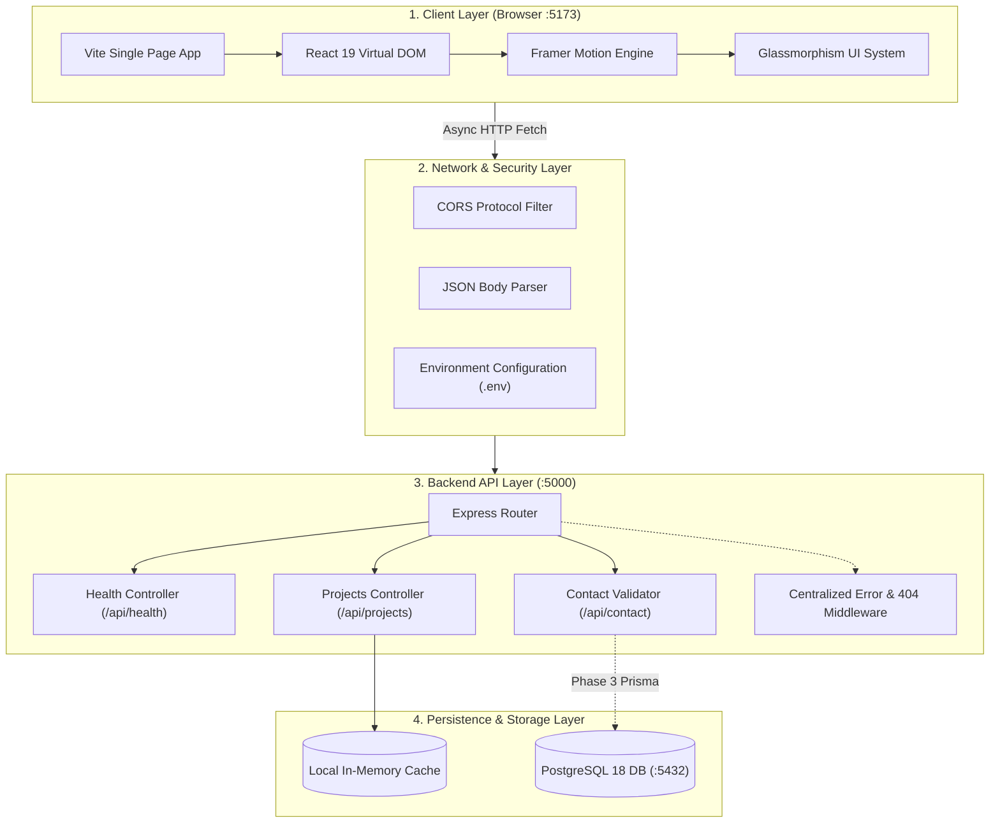

# DevSpace 3D — Complete Full-Stack Architecture & Code Structure Manual

```text
  ██████╗ ███████╗██╗   ██╗███████╗██████╗  █████╗  ██████╗███████╗    ██████╗ ██████╗ 
  ██╔══██╗██╔════╝██║   ██║██╔════╝██╔══██╗██╔══██╗██╔════╝██╔════╝    ╚════██╗██╔══██╗
  ██║  ██║█████╗  ██║   ██║███████╗██████╔╝███████║██║     █████╗       █████╔╝██║  ██║
  ██║  ██║██╔══╝  ╚██╗ ██╔╝╚════██║██╔═══╝ ██╔══██║██║     ██╔══╝       ╚════██╗██║  ██║
  ██████╔╝███████╗ ╚████╔╝ ███████║██║     ██║  ██║╚██████╗███████╗    ██████╔╝██████╔╝
  ╚═════╝ ╚══════╝  ╚═══╝  ╚══════╝╚═╝     ╚═╝  ╚═╝ ╚═════╝╚══════╝    ╚═════╝ ╚═════╝ 
```

> **Developer:** Chandrabhan  
> **Role:** Aspiring Frontend / Full-Stack Engineer  
> **Repository:** DevSpace 3D  
> **Architecture Pattern:** Decoupled Client-Server (SPA + RESTful API)  
> **Frontend Stack:** React 19, Vite 6, Framer Motion, Lucide React, Glassmorphism CSS  
> **Backend Stack:** Node.js, Express, TypeScript, tsx, CORS, dotenv  
> **Database:** PostgreSQL 18 (Local Service Active on Port 5432)  
> **DevOps:** Git Version Control, Ubuntu WSL2, Docker Desktop  

---

## 1. System Architecture Overview

DevSpace 3D follows a modern, decoupled full-stack architecture where the user interface (client) and business logic (server) are developed and maintained independently.



---

## 2. Exhaustive Code Structure & File Inventory

Here is the entire codebase breakdown, explaining the responsibility of every directory and file:

```text
C:\Users\chand\project-name\
│
├── public/                                      # Static web assets directly served without compilation
│   └── vite.svg                                 # Vector icon used in browser tab favicon
│
├── src/                                         # Frontend Application Source Code (React 19)
│   ├── assets/                                  # Static media imported inside React components
│   │   └── react.svg                            # Official React logo vector
│   │
│   ├── components/                              # Reusable, self-contained UI blocks
│   │   ├── Navbar.jsx                           # Fixed glassmorphic navigation bar
│   │   ├── Navbar.css                           # Navigation positioning, blur effects, mobile drawer
│   │   ├── Hero.jsx                             # Hero section with interactive terminal code box
│   │   ├── Hero.css                             # Hero grid, responsive breakpoints, glowing chips
│   │   ├── About.jsx                            # Developer bio and 4-milestone roadmap
│   │   ├── About.css                            # Timeline styling, step badges, goal items
│   │   ├── Skills.jsx                           # Interactive tab filters and progress bars
│   │   ├── Skills.css                           # Filter tab pill styles and animated progress tracks
│   │   ├── Projects.jsx                         # Project showcase cards with WIP concept tags
│   │   ├── Projects.css                         # Card layout, 3D hover transforms, reduced motion
│   │   ├── Header.jsx                           # Modular page header component
│   │   ├── Footer.jsx                           # Site footer with dynamic year and vector social links
│   │   └── Footer.css                           # Footer layout and hover glow effects
│   │
│   ├── data/                                    # Frontend Single Source of Truth
│   │   ├── portfolioData.js                     # Structured arrays for bio, skills, projects, milestones
│   │   └── sampleData.js                        # Starter mock dataset
│   │
│   ├── hooks/                                   # Custom React state logic hooks
│   │   └── useCounter.js                        # Demonstrative hook for reusable state management
│   │
│   ├── pages/                                   # Composite view layouts
│   │   └── Home.jsx                             # Modular landing page layout
│   │
│   ├── styles/                                  # Global CSS & Design Tokens
│   │   ├── index.css                            # CSS variables, fonts, custom scrollbars, dark theme
│   │   └── App.css                              # Ambient 3D orbs, glass cards, buttons, gradient text
│   │
│   ├── App.jsx                                  # Primary layout coordinator & section assembler
│   └── main.jsx                                 # Application entry point rendering into index.html
│
├── backend/                                     # Node.js + Express REST API (TypeScript)
│   ├── src/
│   │   ├── controllers/                         # Request handlers and business validation
│   │   │   ├── health.controller.ts             # Health check responder with uptime metrics
│   │   │   ├── projects.controller.ts           # Portfolio projects JSON feed
│   │   │   └── contact.controller.ts            # Form validation logic (name, email, message)
│   │   │
│   │   ├── routes/                              # REST API Route Declarations
│   │   │   ├── health.routes.ts                 # Maps GET /api/health
│   │   │   ├── projects.routes.ts               # Maps GET /api/projects
│   │   │   └── contact.routes.ts                # Maps POST /api/contact
│   │   │
│   │   ├── middleware/                          # Interceptor pipeline
│   │   │   └── errorHandler.ts                  # Centralized 404 JSON responder & error handler
│   │   │
│   │   ├── data/                                # Backend datasets & interfaces
│   │   │   └── projects.data.ts                 # TypeScript Project model & mock dataset
│   │   │
│   │   └── server.ts                            # Express bootstrap, CORS, JSON middleware, listener
│   │
│   ├── .env                                     # Environment variables (PORT=5000, FRONTEND_ORIGIN)
│   ├── .env.example                             # Public template for environment configuration
│   ├── .gitignore                               # Backend ignore rules (node_modules, dist, .env)
│   ├── package.json                             # Backend dependencies (express, cors, dotenv, tsx)
│   └── tsconfig.json                            # TypeScript NodeNext compilation configuration
│
├── .gitignore                                   # Global Git ignore protecting secrets across repo
├── index.html                                   # HTML entry point with Syne & Plus Jakarta Sans fonts
├── package.json                                 # Frontend dependencies (React 19, Framer Motion, Lucide)
├── vite.config.js                               # Vite build configuration with React plugin
├── README.md                                    # Project overview
├── ARCHITECTURE.md                              # High-level architecture summary
├── CODE_STRUCTURE_AND_ARCHITECTURE.md           # Master architecture reference
└── PROJECT_DOCUMENTATION.md                     # This comprehensive manual
```

---

## 3. Frontend Architecture (Deep-Dive)

### Component Breakdown

#### 1. `Navbar.jsx`
- **Location:** [`src/components/Navbar.jsx`](file:///C:/Users/chand/project-name/src/components/Navbar.jsx)
- **Role:** Floating header providing smooth scrolling to `#hero`, `#about`, `#skills`, `#projects`, and `#contact`.
- **Key Techniques:** Fixed position with glassmorphism blur (`backdrop-filter: blur(16px)`), responsive hamburger toggle using `lucide-react` icons.

#### 2. `Hero.jsx`
- **Location:** [`src/components/Hero.jsx`](file:///C:/Users/chand/project-name/src/components/Hero.jsx)
- **Role:** First impression section.
- **Key Techniques:**
  - Entrance motion transitions powered by `framer-motion`.
  - Glowing status indicator ("Actively Learning & Building Projects").
  - Two-column grid: Left side contains introduction copy and CTA buttons; right side contains an interactive Mac-style code terminal with floating badges ("Three.js Ready", "Framer Motion").

#### 3. `About.jsx`
- **Location:** [`src/components/About.jsx`](file:///C:/Users/chand/project-name/src/components/About.jsx)
- **Role:** Introduces Chandrabhan's background, philosophy, and structured learning roadmap.
- **Key Techniques:**
  - Modern two-column layout.
  - Interactive milestones timeline mapped from `learningMilestones` data array.
  - Explicit labeling of current focus vs completed milestones.

#### 4. `Skills.jsx`
- **Location:** [`src/components/Skills.jsx`](file:///C:/Users/chand/project-name/src/components/Skills.jsx)
- **Role:** Tech stack competency matrix with category filters.
- **Categories:** `All`, `Frontend`, `Tools`, `Currently Learning`.
- **Key Techniques:**
  - Framer Motion `AnimatePresence` and `layout` props for animated grid reflows.
  - Animated progress bars displaying concept learning progress.
  - Transparent disclaimer preventing false seniority claims.

#### 5. `Projects.jsx`
- **Location:** [`src/components/Projects.jsx`](file:///C:/Users/chand/project-name/src/components/Projects.jsx)
- **Role:** Showcase of portfolio projects (DevSpace 3D, AstroExplore, FocusFlow).
- **Key Techniques:**
  - 3D hover elevation effects.
  - Status badges (`Work in Progress`, `Concept / Planned`).
  - Interactive placeholder buttons triggering animated alert toasts.
  - Accessibility compliant: `@media (prefers-reduced-motion: reduce)` disables heavy transforms.

#### 6. `Footer.jsx`
- **Location:** [`src/components/Footer.jsx`](file:///C:/Users/chand/project-name/src/components/Footer.jsx)
- **Role:** Site footer displaying social channels (GitHub, LinkedIn, Twitter/X, Email) and copyright.

---

## 4. Backend REST API Architecture (Deep-Dive)

### Endpoints Reference

#### 1. GET `/api/health`
- **Purpose:** Server heartbeat and health check.
- **Controller:** [`backend/src/controllers/health.controller.ts`](file:///C:/Users/chand/project-name/backend/src/controllers/health.controller.ts)
- **Response `200 OK`:**
```json
{
  "success": true,
  "message": "API is running",
  "timestamp": "2026-10-13T17:19:29.441Z",
  "uptimeSeconds": 240
}
```

#### 2. GET `/api/projects`
- **Purpose:** Fetches portfolio projects feed.
- **Controller:** [`backend/src/controllers/projects.controller.ts`](file:///C:/Users/chand/project-name/backend/src/controllers/projects.controller.ts)
- **Response `200 OK`:**
```json
{
  "success": true,
  "count": 3,
  "data": [
    {
      "id": "p1",
      "title": "DevSpace 3D",
      "tagline": "Developer Portfolio with Glassmorphic 3D Aesthetics",
      "status": "Work in Progress (Active)",
      "statusType": "active",
      "tags": ["React", "Vite", "Framer Motion", "CSS3", "Node.js", "Express"]
    }
  ]
}
```

#### 3. POST `/api/contact`
- **Purpose:** Validates contact form submissions.
- **Controller:** [`backend/src/controllers/contact.controller.ts`](file:///C:/Users/chand/project-name/backend/src/controllers/contact.controller.ts)
- **Request Body:**
```json
{
  "name": "Chandrabhan",
  "email": "chandrabhan@example.com",
  "message": "Hello from the contact form!"
}
```
- **Validation Rules:**
  - `name`: String, minimum 2 characters.
  - `email`: Regex validated RFC 5322 format.
  - `message`: String, minimum 5 characters.
- **Success Response `200 OK`:**
```json
{
  "success": true,
  "message": "Message validated successfully. (Note: Database persistence will be connected in Phase 2/3).",
  "data": {
    "name": "Chandrabhan",
    "email": "chandrabhan@example.com",
    "receivedAt": "2026-10-13T17:19:39.481Z"
  }
}
```

---

## 5. Development Workflow & Commands Reference

### Windows PowerShell Commands

| Task | Command | Directory |
| :--- | :--- | :--- |
| **Start Frontend Server** | `npm run dev` | `C:\Users\chand\project-name` |
| **Build Frontend** | `npm run build` | `C:\Users\chand\project-name` |
| **Start Backend Server** | `npm run dev` | `C:\Users\chand\project-name\backend` |
| **Build Backend** | `npm run build` | `C:\Users\chand\project-name\backend` |
| **Test Health Endpoint** | `Invoke-RestMethod http://localhost:5000/api/health` | Anywhere |
| **Test Projects Endpoint** | `Invoke-RestMethod http://localhost:5000/api/projects` | Anywhere |
| **Git Status Check** | `git status` | `C:\Users\chand\project-name` |
| **Git Log History** | `git log --oneline` | `C:\Users\chand\project-name` |
| **Enter Linux Terminal** | `wsl` | Anywhere |
